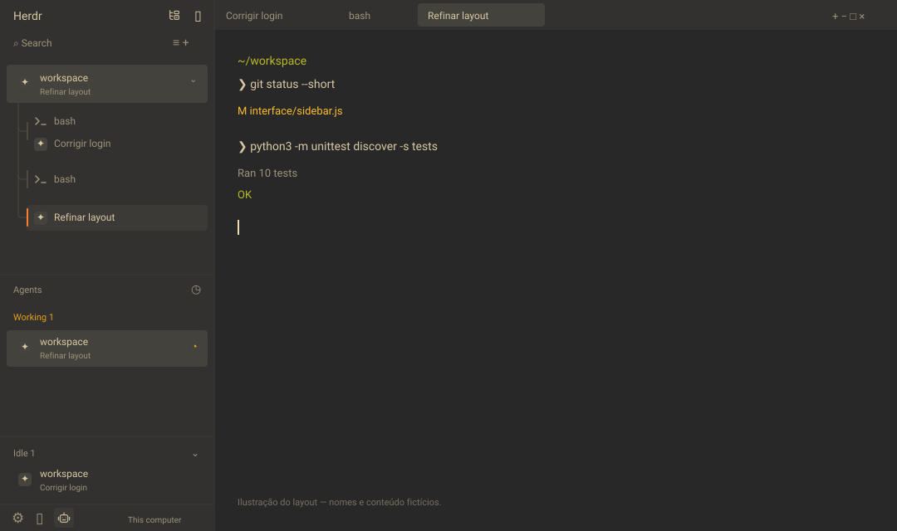

# herdr-warp

Uma experiência visual inspirada no **Warp com Gruvbox**, construída como uma camada de personalização do [Noctua](https://github.com/othavi0/noctua-layout) para o [Herdr](https://github.com/herdrdev/herdr-app).



O projeto mantém o modelo do Herdr: **spaces na sidebar, abas no topo e splits dentro das abas**. Agents, Idle, menus, botões, Files e Changes continuam disponíveis. O resultado aproxima o visual do Warp, sem substituir o terminal ou alterar seu código-fonte.

## O que muda

- Paleta Gruvbox Dark, destaque laranja, hover e seleção com cores inspiradas no Warp.
- Roboto na interface, títulos de 12 px e subtítulos de 10 px, com altura de linha 1.2.
- Sidebar de 248 px, ícones circulares de 24 px e ajustes de espaçamento e alinhamento.
- Nome do space na primeira linha; título da aba ativa na segunda.
- Terminais ociosos mostram o shell, como `bash` ou `zsh`, em vez de endereços como `t1`. Programas ativos e nomes manuais continuam respeitados.
- Terminal com JetBrainsMono Nerd Font, tamanho-base 13, padding `[14, 12]` e opacidade interna de 84%.
- Barra inferior de pasta/branch da área do terminal oculta.
- Opção de usar **Ctrl+V para colar**, preservando os demais atalhos.

## Requisitos

- Herdr app — validado com a versão **0.1.13 no Linux**.
- Python **3.10 ou posterior**; o instalador usa somente a biblioteca padrão.
- `git` para clonar este projeto e para as funções de repositórios do Noctua.
- **JetBrainsMono Nerd Font instalada no sistema**. Ela não está incluída; Roboto está incluída com sua licença.
- Acesso à internet para obter a revisão fixada do Noctua. Uma cópia local também pode ser usada.

## Instalar

```sh
git clone https://github.com/vitordiricio/herdr-warp.git
cd herdr-warp

# Conferir o que será instalado, sem alterar o destino:
./scripts/install.sh --dry-run

# Instalar e ativar no Herdr aberto:
./scripts/install.sh --activate
```

Para instalar também o ajuste de Ctrl+V:

```sh
./scripts/install.sh --ctrl-v --activate
```

Por padrão, o destino é `${HERDR_APP_HOME:-~/.config/herdr-app}`. Também é possível usar `--home /caminho/para/herdr-app`. O instalador prepara tudo numa pasta temporária antes de escrever e cria um backup dos arquivos substituídos em `backups/herdr-warp-<data>/`, com um manifesto dos arquivos anteriores e novos.

Ele instala `layouts/warp-gruvbox.*`, `themes/warp-gruvbox.json`, `mods/warp-*`, as fontes Roboto e os avisos de licença. Não altera os mods originais Noctua. O ajuste opcional de Ctrl+V mescla somente essa tecla na seção `terminal` de `keys.json`.

Se instalar sem `--activate`, ative depois:

```sh
herdr-app do layout.switch --name warp-gruvbox
```

O zoom pessoal é preservado. As medidas acima são as medidas-base, em 100%. Para voltar a essa escala, use `Ctrl+0` no Herdr ou:

```sh
herdr-app do app.zoom_reset
```

## Como o pacote funciona

Não é um fork do binário do Herdr. O instalador obtém a revisão do Noctua registrada em [`upstream.json`](upstream.json), confere os hashes dos arquivos necessários, cria cópias `warp-*` e aplica as transformações de [`scripts/style.py`](scripts/style.py). A revisão está fixada para que mudanças futuras do Noctua não alterem o resultado silenciosamente.

O Noctua não declara uma licença de redistribuição nessa revisão. Por isso, seus mods completos não são incluídos neste repositório: o original é obtido diretamente do projeto durante a instalação. As licenças dos recursos redistribuídos e os créditos estão em [THIRD_PARTY.md](THIRD_PARTY.md).

Para instalar usando uma cópia local da revisão esperada:

```sh
git clone https://github.com/othavi0/noctua-layout.git /tmp/noctua-layout
git -C /tmp/noctua-layout checkout f42f701e85c3e99b04eca721a240144f8f67c9ef
./scripts/install.sh --noctua-source /tmp/noctua-layout --activate
```

## O que fica fora

Sessões, terminais em execução, nomes dos seus spaces, histórico, diretórios de projetos, credenciais, estado de painéis e configurações pessoais não fazem parte do pacote. `settings.json`, `view.json`, `shared.json` e `data/` não são publicados nem copiados do computador de origem.

O código dos mods mantém as funções do Noctua: consultas Git para branches e mudanças; leitura de arquivos em Files; e ações de commit em Changes quando acionadas pelo usuário. O download das dependências acontece no instalador; esta personalização não adiciona chamadas de rede aos mods.

## Limites e reversão

A opacidade de 84% é a opacidade **interna** que o Herdr suporta. Não produz transparência da janela sobre o desktop nem blur. Renderização de fontes, detecção de programas e outras funções continuam dependendo do Herdr e do sistema. Não é uma cópia idêntica do Warp e não tem afiliação com os projetos citados.

Para deixar de usar o layout, escolha outro no Herdr, pressione `Ctrl+Shift+L` ou execute:

```sh
herdr-app do layout.switch --name main
```

Para desfazer substituições de arquivos, restaure os caminhos listados em `previous` no `manifest.json` do backup correspondente. A lista `new` identifica os arquivos que antes não existiam. Se usou `--ctrl-v`, a versão anterior de `keys.json`, quando existente, está nesse mesmo backup. Não restaure arquivos de outros backups sem conferir suas alterações posteriores.

## Desenvolvimento

```sh
python3 -m unittest discover -s tests -v
```

Depois de instalar num destino de teste, valide os mods com `herdr-app check <destino>/mods/warp-<nome>`. Os oito mods e a geração do layout foram comparados com a configuração de referência e validados no Herdr 0.1.13. Os testes do instalador verificam preservação de atalhos, backup, dry run e rejeição de dependências incompatíveis.

Contribuições à camada de personalização estão sob MIT; os componentes de terceiros mantêm suas próprias licenças.
